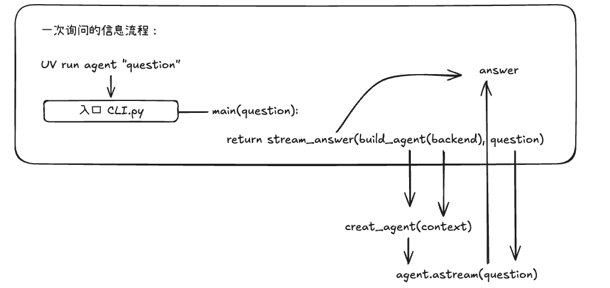
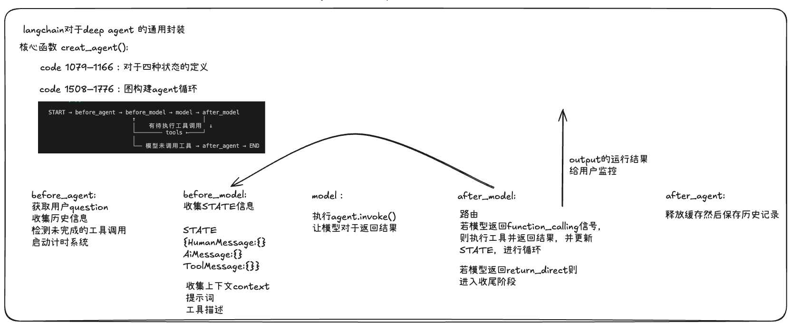
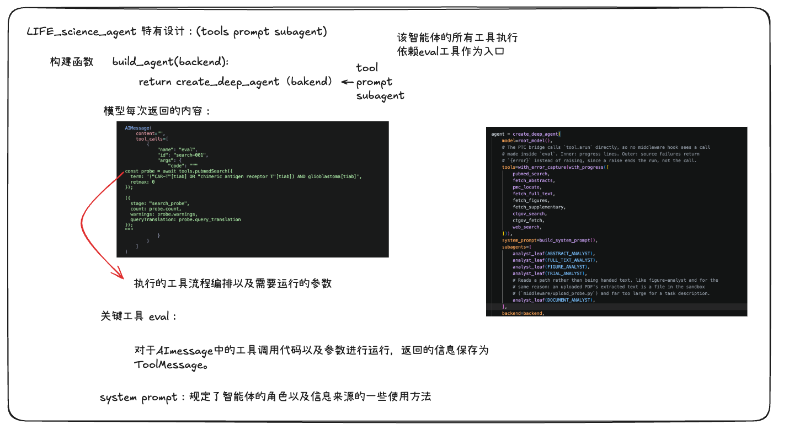
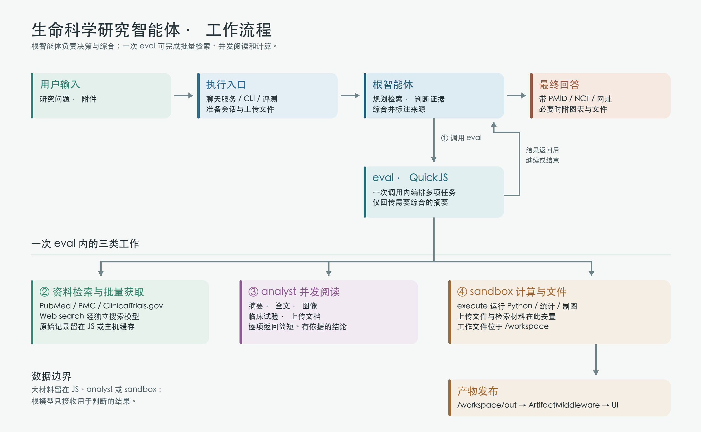

最近在阅读 [Deep Life Sci](https://github.com/langchain-samples/deep-life-sci) 的代码。它是一个面向生命科学研究的 Agent，可以检索 PubMed 和 PMC、读取 ClinicalTrials.gov 的临床试验记录，也可以在沙箱中运行 Python、分析数据并生成图表。

> 本文基于本地仓库的 `83009f8` 提交阅读，使用的依赖版本为 Deep Agents 0.7.4、LangChain 1.3.14、LangGraph 1.2.10、langchain-quickjs 0.3.5。后续版本的内部节点和接口可能会变化。

## 1. 单次问询的信息传输流程


聊天服务通过下面的命令启动：

```bash
uv run scripts/dev.py
```

通过一下命令启动一次任务：

```bash
uv run agent "Find recent papers on base editing in the liver"
```

运行命令后通过build_agent（）创建了一个agent实例，可以把 `build_agent()` 返回的 Agent 理解成一个已经组装好的可执行函数。后续的回答就是agent()对于question的处理。
执行顺序可以简化为：

```text
uv run agent "question"
    ↓
cli.run() 读取问题
    ↓
main() 创建 Sandbox
    ↓
build_agent(backend) 创建 Agent
    ↓
agent.astream(question) 流式执行并输出回答
```

对应的核心代码可以理解成：

```python
async def main(question):
    async with sandbox_session() as backend:
        agent = build_agent(backend)

        async for chunk, metadata in agent.astream(
            {"messages": [{"role": "user", "content": question}]},
            stream_mode="messages",
        ):
            if is_root_text(chunk, metadata):
                print(chunk.text, end="")
```

> 源码位置：服务启动 `scripts/dev.py:243-329`；Graph 注册 `langgraph.json:1-9`；聊天请求入口 `deep_life_sci/graph.py:128-171`；单次 CLI 与 `astream` 调用 `deep_life_sci/cli.py:53-109`。

## 2. 通用的 Deep Agent 内部 Agent Loop



Deep Life Sci 使用 `create_deep_agent()` 构建智能体。继续向下追踪可以看到，Deep Agents 最终仍然调用了 LangChain 的 `create_agent()`，并由 LangGraph 编译成一张状态图。

> 源码位置：Deep Agents 的 `deepagents/graph.py:268-925`；LangChain 的 `langchain/agents/factory.py:1502-1775`。这两个文件位于本地 `.venv` 的 `site-packages` 中。

理解这部分之前，要先区分两个概念：

- **State** 是贯穿整次运行的数据，例如用户消息、模型回复、工具结果、附件信息和 UI 产物。
- **Node** 是处理 State 的步骤。节点读取当前 State，完成一项工作，再把新增内容写回 State。

所以 `before_agent`、`model`、`tools` 这些是节点或中间件阶段，并不是五种不同的 State。为了方便理解，可以把一次循环简化为下面几个阶段：

| 阶段 | 什么时候执行 | 主要作用 |
|---|---|---|
| `before_agent` | 每次运行开始时 | 处理用户输入、附件和需要恢复的会话状态 |
| `before_model` | 每次模型调用前 | 整理上下文、补充 System Prompt、做上下文压缩 |
| `model` | 循环中 | 让模型判断下一步：直接回答，或者产生工具调用 |
| `after_model` | 每次模型调用后 | 更新中间状态，并执行各中间件的收尾逻辑 |
| `tools` | 模型产生工具调用时 | 真正执行工具，并把结果作为 `ToolMessage` 写回 State |
| `after_agent` | 整次运行结束时 | 保存需要跨轮次保留的状态，释放本轮运行资源 |

其中 `tools` 是一个独立节点，不是 `after_model` 自己在执行工具。正常情况下，路由关系可以写成下面这段伪代码：

```text
state.messages = [HumanMessage(question)]

before_agent(state)

while True:
    before_model(state)
    reply = model(state.messages, system_prompt, tool_schemas)
    state.messages.append(reply)
    after_model(state)

    if reply 没有工具调用:
        break

    results = tools.execute(reply.tool_calls)
    state.messages.extend(results)

after_agent(state)
return state
```

模型第一次拿到问题时，通常不会直接给出最终答案，而是先调用检索工具。工具执行结果进入 State 后，流程重新回到 `before_model`，模型根据新证据继续判断。直到某次模型回复里不再包含工具调用，循环才会结束。

这就是 Agent 能完成复杂任务的基础：它不是提前写死一条工作流，而是在每一轮根据已有结果决定下一步。Deep Life Sci 的特殊设计，也都是建立在这个通用循环之上的。

## 3. Deep Life Sci 的独特设计



`deep_life_sci/agent.py` 是最适合进入这个项目的文件。它没有实现具体的检索算法，而是把整个系统需要的组件集中装配起来。省略一些配置后，结构大致如下：

```python
def build_agent(backend):
    return create_deep_agent(
        model=root_model(),
        tools=[
            pubmed_search,
            fetch_abstracts,
            pmc_locate,
            fetch_full_text,
            fetch_figures,
            fetch_supplementary,
            ctgov_search,
            ctgov_fetch,
            web_search,
        ],
        system_prompt=build_system_prompt(),
        subagents=[
            abstract_analyst,
            full_text_analyst,
            figure_analyst,
            trial_analyst,
            document_analyst,
        ],
        backend=backend,
        middleware=[
            UploadMiddleware(backend),
            UpdateCadence(),
            CodeInterpreterMiddleware(ptc=[...]),
            ArtifactMiddleware(backend),
            LoopLagProbe(),
        ],
    )
```

这个构建函数基本说明了项目的设计重点：一个根模型负责决策，`eval` 负责任务编排，专业子 Agent 负责阅读，Sandbox 负责计算和文件，数据源工具负责可靠地取回原始材料。

> 源码位置：`deep_life_sci/agent.py:39-140`。

### 3.1 `eval`：把多次工具调用压进一次循环

普通 Agent 一般是这样的：模型调用一次工具，拿到结果，再调用模型决定下一个工具。假如要处理 50 篇论文，模型可能要在 Agent Loop 中来回很多次，不仅慢，根模型还需要一直携带前面返回的大段内容。

Deep Life Sci 加入了 `CodeInterpreterMiddleware`，为根模型提供一个名为 `eval` 的 JavaScript 解释器。它运行在 QuickJS 中，可以在一次 `eval` 调用里完成循环、条件判断、并发和批量工具调用。例如一轮文献分析可以写成：

```javascript
const question = "Which papers used in vivo mouse models?";
let term = '"base editing"[tiab] AND liver[tiab]';

const probe = await tools.pubmedSearch({
  term,
  retmax: 0,
});

// 根据 probe.count 和 warnings 调整查询后，再正式获取记录
const search = await tools.pubmedSearch({ term, retmax: 200 });
const pmids = search.records.map((paper) => paper.pmid);
const abstracts = await tools.fetchAbstracts({ pmids });

const answers = await Promise.all(
  Object.values(abstracts.records).map((paper) =>
    task({
      subagentType: "abstract-analyst",
      description: `Question: ${question}\n\n${paper.abstract}`,
    })
  )
);

({ count: search.count, answers });
```

上面只是为了说明逻辑的伪代码，真实 Prompt 还要求检查查询翻译、错误、缺失记录和撤稿状态。

这里相当于将具体的获取全文、代码运行以及推理的具体流程下方到更具体的组件中进行处理，根智能体只负责编排流程以及推理工具运行所需的value，将计划与运行解耦。实现了模型能够针对调研结果或者实验结果调整设计方案，实现探索或者方案实现的迭代。

一次 `eval` 也不等于把整项研究写成固定脚本。它更像完成当前这一批工作：结果回到根模型后，根模型仍然可以发现关键词不准确、全文证据不够或者需要补查临床试验，然后修改方案，再发起下一次 `eval`。动态调整研究路线的能力仍然来自外层 Agent Loop。

> 源码位置：项目中的 QuickJS 与 PTC 配置 `deep_life_sci/agent.py:99-130`；解释器中间件 `langchain_quickjs/middleware.py:121-476`。

### 3.2 System Prompt

这个项目的 System Prompt 很长，但并不是简单堆叠“你是一名严谨的生物信息学家”之类的角色描述。它主要在规定数据应该怎样流动，以及什么结果可以被当作证据。

我把其中比较重要的规则归纳成下面几类：

| 规则 | 解决的问题 |
|---|---|
| 先用 `retmax: 0` 探测命中数量，再调整查询 | 避免随便截取前 N 篇，漏掉真正相关的论文 |
| 检查 PubMed 的 `query_translation` 和 `warnings` | 防止错误字段被 PubMed 静默改写后仍得到“看似正常”的结果 |
| 按“摘要 → 文章结构 → 指定章节 → 全文”逐级读取 | 不为一个摘要就能回答的问题付出整篇全文的上下文成本 |
| 先看图注，只有必要时才读取图像 | 大部分图表问题可以从图注得到答案，图像留给专门的视觉子 Agent |
| 临床试验的注册计划和已发布结果必须分开 | 防止把预计入组人数、计划结局误写成真实结果 |
| 每个结论都要带 PMID、NCT 或网页来源 | 让最终答案能够被追溯和复核 |
| 大数据保留在 JS、子 Agent 或 Sandbox 中 | 控制根模型的上下文长度 |

其明确规范了模型的使用工具以及推理需要注意的要点。但是这也导致了提示词与工具组成高度耦合，使得其system prompt非常的长。
> 源码位置：`deep_life_sci/prompts/system.py:23-890`。

### 3.3 工具和子 Agent：先批量取回，再并行阅读

Deep Life Sci 的工具大致可以分成四组：

| 工具组 | 代表工具 | 作用 |
|---|---|---|
| 文献检索 | `pubmedSearch`、`fetchAbstracts` | 搜索 PubMed，批量获取并缓存摘要 |
| 全文与附件 | `pmcLocate`、`fetchFullText`、`fetchFigures`、`fetchSupplementary` | 定位 PMC 全文，按章节读取，并把图和补充材料放入 Sandbox |
| 临床试验 | `ctgovSearch`、`ctgovFetch` | 搜索并读取 ClinicalTrials.gov 记录 |
| 通用研究能力 | `webSearch`、`execute`、文件工具 | 补充开放网页信息，运行计算并生成文件 |

这些工具负责“取得材料”，五类子 Agent 负责“读材料”：

| 子 Agent | 输入 | 可用工具 | 主要任务 |
|---|---|---|---|
| `abstract-analyst` | 单篇摘要文本 | 不需要工具 | 回答这篇摘要是否支持某个结论 |
| `full-text-analyst` | 单篇全文或指定章节 | 不需要工具 | 提取方法、数值、样本量和限制 |
| `figure-analyst` | 图像路径和图注 | `read_file` | 读取图像，解释坐标、分组和差异 |
| `trial-analyst` | 临床试验记录或分段文件 | `read_file`、`grep` | 区分试验设计、状态和真实结果 |
| `document-analyst` | 用户上传 PDF 的文本路径 | `read_file` | 阅读不在 PMC 中的用户文档 |

这里没有让每个子 Agent 自己去搜索。正确的顺序是根 Agent 先批量检索和获取，再把一篇材料分给一个子 Agent。这样做有三个好处：

1. 数据源的限速和缓存集中在一处，不会出现几十个子 Agent 同时请求 NCBI。
2. 每个子 Agent 只看一篇材料，任务边界清楚，不容易把不同论文的结论混在一起。
3. 大段摘要和全文停留在子 Agent 的上下文里，根模型只接收两三句话的结论。

子 Agent 的能力也被刻意限制。摘要和全文分析器按照 Prompt 约束，只根据任务中给出的文本回答；图像和上传文档分析器使用 `read_file`；临床试验分析器再多一个 `grep`。从具体实现看，Deep Agents 的 `FilesystemMiddleware` 会为所有叶子保留 `read_file` 这一最低能力，但摘要和全文分析器的任务根本不需要用到它。这样的限制看起来不够“智能”，却能避免分析器脱离给定证据自行补充知识，也让结果更容易追溯。

> 源码位置：子 Agent 权限配置 `deep_life_sci/agent.py:46-62`；五类子 Agent 的 Prompt `deep_life_sci/prompts/subagents.py:16-222`。

### 3.4 文献和数据来源

项目接入的数据不只是一套搜索 API，不同来源承担的角色也不一样：

| 来源 | 能获得什么 | 主要限制 |
|---|---|---|
| PubMed | 论文元数据、摘要、PMID、DOI、PMCID | 有些记录没有摘要；错误查询可能被静默改写 |
| PubMed Central（PMC） | 开放获取全文、章节、图注、表格、图像和补充材料 | 只有进入 PMC 的论文才能获取全文，部分材料受再分发许可限制 |
| ClinicalTrials.gov | 试验注册、状态、设计、干预、结局指标和已提交结果 | 注册信息可能只是计划，不能自动当作研究结果 |
| Web Search | 指南、监管信息、药品标签、公司公告等开放网页 | 不是同行评审文献，需要保留网页来源并降低证据等级 |
| 用户上传 | 表格、PDF、引文库、序列、化合物和图片 | 需要先解析并放入 Sandbox，不能把原始大文件直接塞给根模型 |

> 源码位置：PubMed `deep_life_sci/sources/pubmed.py:363-656`；PMC `deep_life_sci/sources/pmc.py:593-1003`；ClinicalTrials.gov `deep_life_sci/sources/ctgov.py:433-613`；Web Search `deep_life_sci/sources/web.py:211-270`；上传文件 `deep_life_sci/middleware/uploads.py:447-784`。

## 4. 整体框架



把上面的模块合在一起，一次完整研究任务可以概括为：

```text
用户问题 / 附件
      ↓
CLI 或聊天服务准备会话与 Sandbox
      ↓
根 Agent 规划检索、判断证据是否充足
      ↓
eval 在 QuickJS 中批量调用检索工具、task 和 execute
      ↓
专业子 Agent 并行阅读摘要、全文、图像或试验记录
      ↓
根 Agent 只接收压缩后的结论，继续检索或开始综合
      ↓
最终回答附 PMID / NCT / URL
需要交付文件时：/workspace/out → ArtifactMiddleware → UI
```
