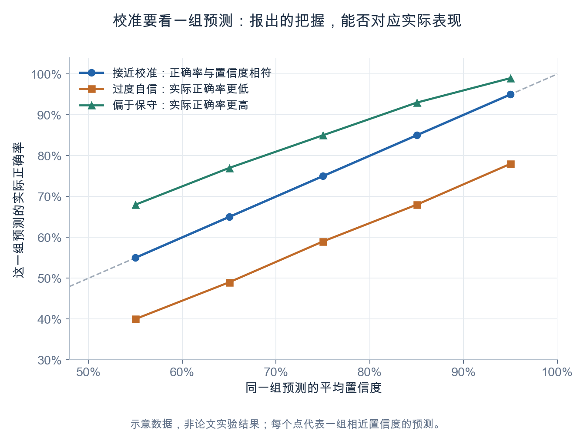
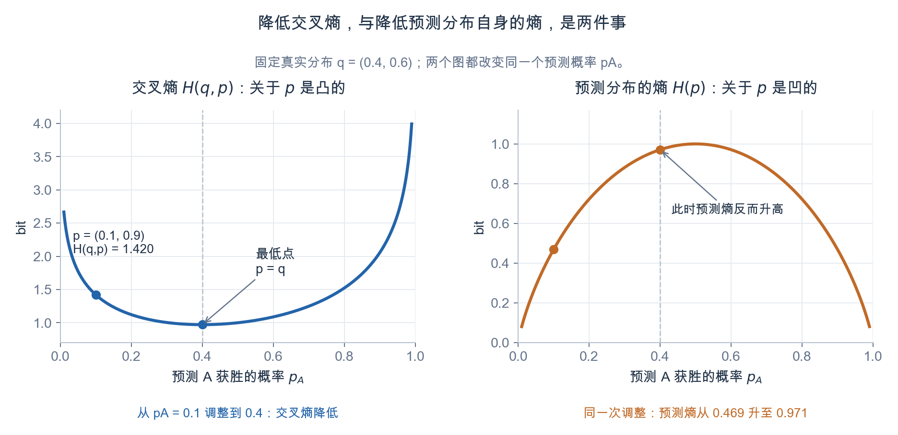
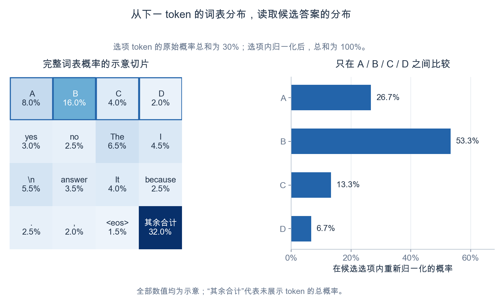
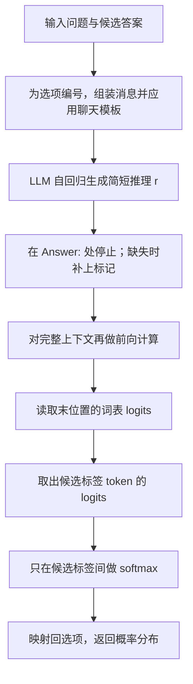

最近在读 *OpenJev-RLCD: A Working RLCD Implementation*。在理解具体的强化学习算法之前，我想先弄清楚一个更基础的问题：一个原本预测下一个 token 的 LLM，怎样变成能够返回选项概率的决策模型？这些概率又应该怎样理解和评价？

这篇先沿着三个问题整理我的理解：从电竞比赛的胜率预测理解概率校准，用交叉熵理解概率预测的评价目标，最后结合代码看看选项概率究竟是怎么读出来的。RLCD 的训练方法留到后面继续讨论。

> 阅读版本：[论文 arXiv v1，2026-09-30](https://arxiv.org/abs/2609.38850v1)；代码示例固定到仓库提交 [`0de429f`](https://github.com/ZimmyGao/openjev-rlcd/tree/0de429fd49627e98e9ad9aeb83ff4f43dc66c963)。同一论文编号的 v2 已经改题并调整了方法表述，这里沿用 v1。文中的比赛、图表数值和示例输出均用于说明概念，不是模型实测结果。

## 1. 校准概率任务的定义

### 1.1 从电竞比赛的“四六开”说起

生活中的很多预测都带有不确定性。例如，两个电竞战队即将进行比赛，我们通常不只会预测谁获胜，还会说“两队四六开”或者“二八开”。

假设我们判断 A 队获胜的概率是 40%，B 队是 60%，那么给出的预测就是一个分布：

$$
p=(0.4,\;0.6).
$$

如果只取概率较大的选项，预测结果就是“B 队获胜”。但 60% 与 99% 表达的把握显然不同。**概率分布提供了最终选择之外的不确定性信息**，这也是我觉得它值得单独研究的原因。

为了区分真实情况与模型预测，下面统一用 $$q$$ 表示真实结果分布，用 $$p$$ 表示模型报告的分布。两者都是离散结果上的**概率质量函数**。

我们可以把真实概率理解为：假想在相同条件下，独立重复进行非常多次比赛，A 队获胜的比例会趋近什么值。若条件记为 $$x$$，那么：

$$
q_A=\Pr(Y=A\mid x),\qquad q_B=1-q_A.
$$

这里需要注意，假如真的做了 100 次重复试验，A 队赢了 40 次，得到的 $$40/100$$ 也只是一个**频率估计**，不能据此断定真实概率恰好是 0.4。现实比赛还会受到选手状态、版本、对手策略等条件变化的影响，更难实现这种理想化重复。

因此，我们往往只能根据过往战绩、近期表现和其他已知信息，估计一个无法直接观察到的条件概率。

### 1.2 拟合真实分布与校准的区别

让模型的 $$p$$ 尽可能接近 $$q$$，是概率预测的目标。而“校准”更具体地关心：**模型报出的概率，是否与相应预测的实际表现一致。**

例如，把模型报出约 60% 把握的判断收集起来，它们的实际正确率是否也接近 60%？如果实际只有 40% 正确，模型就过于自信；如果有 80% 正确，它又显得过于保守。

设模型选出的答案是 $$\hat Y$$，把被选选项的概率 $$c=\max_k p_k$$ 作为置信度，常见的置信度校准条件可以写成：

$$
\Pr(\hat Y=Y\mid c=s)=s.
$$

这个定义可以参看 [Guo 等人的校准论文](https://proceedings.mlr.press/v70/guo17a/guo17a.pdf)。在有限数据上，通常会把相近置信度的预测分组，再比较组内的平均置信度和实际正确率。


_图 1：对角线表示置信度与正确率相符。图中数据为示意，每个点代表一组预测。_

所以，某一次报出 60% 把握却答错了，并不能直接说明模型没有校准。要检验这个数字，需要观察许多类似预测。

校准也不等于准确率高。假设一个模型所有预测都报 60% 的把握，整体也恰好有 60% 正确，它可以满足上面的校准条件，却无法进一步区分哪些题更容易答对。恢复完整的真实条件分布，比满足这一分组条件要求更强。

## 2. 用交叉熵评价概率预测

在学习这部分时，我也顺带接触了一些信息论知识。把熵、交叉熵和 KL 散度放在一起看，能够比较清楚地理解“让预测分布接近真实分布”是什么意思。

### 2.1 固定真实分布，比较不同的概率报告

设结果集合是 $$\mathcal{Y}=\{y_1,\ldots,y_K\}$$，真实分布为 $$q$$，模型预测为 $$p$$。它们的交叉熵为：

$$
H(q,p)=-\sum_{k=1}^{K}q_k\log_2 p_k.
$$

使用以 2 为底的对数时，单位是 bit；训练代码常用自然对数，两者只相差一个常数倍，不改变最优分布。

继续用比赛的例子，假设真实分布为 $$q=(0.4,0.6)$$，比较下面两种预测：

| 概率报告 | A 队获胜概率 | B 队获胜概率 | 交叉熵 $$H(q,p)$$ |
|---|---:|---:|---:|
| $$p_1$$ | 0.4 | 0.6 | 约 0.971 bit |
| $$p_2$$ | 0.1 | 0.9 | 约 1.420 bit |

两个预测都会选择 B 队，但它们对不确定性的描述不同。$$p_2$$ 给 B 队的概率过高；当 A 队获胜时，它会受到更大的对数损失。按真实分布对两种结果取平均，$$p_1$$ 的交叉熵更小。

交叉熵之所以能够评价这种偏差，可以通过下面的分解理解：

$$
\begin{aligned}
H(q,p)&=H(q)+D_{\mathrm{KL}}(q\|p),\\
H(q)&=-\sum_k q_k\log_2 q_k,\\
D_{\mathrm{KL}}(q\|p)&=\sum_k q_k\log_2\frac{q_k}{p_k}.
\end{aligned}
$$

真实分布 $$q$$ 固定时，$$H(q)$$ 是常数。又因为 KL 散度非负，所以交叉熵在 $$p=q$$ 时取得最小值。

### 2.2 降低交叉熵，不等于降低预测分布自身的熵

这里有两个容易混淆的点。

首先，对于固定的 $$q$$，交叉熵 $$H(q,p)$$ **关于预测概率 $$p$$ 是凸函数**。熵 $$H(p)$$ 关于 $$p$$ 才是凹函数。把 $$p$$ 换成由神经网络参数决定的 $$p_\theta$$ 后，损失关于参数 $$\theta$$ 一般并不是凸的。

其次，降低交叉熵，意味着减少预测与真实分布之间的偏差；预测分布自身的熵 $$H(p)$$ 则可能升高，也可能降低。


_图 2：固定 $$q=(0.4,0.6)$$。把预测从 $$(0.1,0.9)$$ 调整为 $$(0.4,0.6)$$，交叉熵下降，但预测分布自身的熵上升。两张图的纵轴范围不同。_

在这个例子里，预测分布自身的熵从约 0.469 bit 上升到 0.971 bit，概率报告却变得更准确了。因为真实结果本来就有不确定性，合理的预测也应保留这部分不确定性。

因此，我更愿意把这个优化过程理解为“让报告的分布接近真实分布”。笼统地称为“熵减”，容易误以为应该总让模型更确定。

### 2.3 不知道真实概率，也可以用观测结果学习

前面的计算假设我们知道 $$q$$。现实中，更常见的是只观察到一批输入与结果 $$\{(x_i,y_i)\}_{i=1}^{N}$$，然后最小化平均负对数似然：

$$
\widehat{\mathcal L}(\theta)
=-\frac{1}{N}\sum_{i=1}^{N}\log_2 p_\theta(y_i\mid x_i).
$$

对于同一个条件 $$x$$，如果结果确实来自 $$q(\cdot\mid x)$$，那么：

$$
\mathbb E_{Y\sim q(\cdot\mid x)}[-\log_2 p_\theta(Y\mid x)]
=H\big(q(\cdot\mid x),p_\theta(\cdot\mid x)\big).
$$

也就是说，单次观测只告诉我们发生了哪个结果，但在期望意义下，这种损失仍然指向真实分布。实践中不必把同一场比赛真的重复无数次，而是让模型从许多样本中学习可共享的规律。

交叉熵评价的是整体概率预测质量，也会受到模型区分不同样本能力的影响。因此，更低的交叉熵有意义，但要判断校准情况，还应结合前面的分组统计等方法。

## 3. 基于 LLM 的校准概率模型

### 3.1 Jev 的接口：给定状态和问题，返回选项概率

[TypeSafe AI](https://typesafe.ai/) 推出的 Jev，是我关注这类模型的一个起点。厂商将其训练方法称为 **Reinforcement Learning for Calibrated Decisions（RLCD）**。根据 [官方 Choice 文档](https://docs.typesafe.ai/primitives/choice)，使用者可以提供待判断的内容、问题以及候选选项，获得选项上的概率分布。

沿用电竞比赛的例子，一个符合接口结构的请求体可以写成下面这样。它可以提交到 `POST https://api.typesafe.ai/v1/systemone`：

```json
{
  "model": "jev-latest",
  "state": "一场虚构的 A 队对 B 队比赛。A 队近 10 场 6 胜，B 队近 10 场 7 胜；双方均以常规阵容参赛。",
  "questions": {
    "winner": {
      "type": "choice",
      "instructions": "根据已知信息，判断哪支队伍更可能获胜。",
      "criteria": {
        "team_a": "A 队获胜",
        "team_b": "B 队获胜"
      }
    }
  }
}
```

只展示我们关心的返回字段，其形式类似：

```json
{
  "choice": "team_b",
  "probabilities": {
    "team_a": 0.4,
    "team_b": 0.6
  }
}
```

这里的数值是为了说明接口而填写的示例，没有实际调用模型。官方接口还有单独的 `confidence` 字段，其定义与选项概率有所区别；本文主要关注 `probabilities`。[官方说明](https://docs.typesafe.ai/confidence) 对此有专门解释。

不过，接口能够返回概率，还不能告诉我们这些概率是怎样训练出来的。本文参考的 [OpenJev-RLCD](https://github.com/ZimmyGao/openjev-rlcd) 是一个独立的社区实现，论文也明确说明，它不声称还原了 Jev 内部的训练算法。

接下来讨论的是：这个社区项目怎样利用 LLM 构造类似的选项概率输出。

### 3.2 LLM 本来就会给下一个 token 分配概率

自回归 LLM 每生成一个 token，都会根据已有上下文计算下一个 token 的分数。通常经过语言模型输出头 `lm_head`，得到覆盖整个词表的 logits 向量 $$z$$，再经 softmax 得到概率：

$$
P(t=v\mid\text{context})
=\frac{\exp(z_v)}{\sum_{w\in V}\exp(z_w)},
$$

其中 $$V$$ 是词表。logits 是尚未归一化的分数，可以是任意实数；softmax 后才是概率。

如果我们规定候选答案只用 `A / B / C / D` 表示，那么到达答案位置时，就可以专门取出这些标签 token 的分数，只在它们之间归一化。


_图 3：左图展示词表概率的示意切片，“其余合计”汇总未展示的 token。四个选项原来只占 30% 的概率质量；在选项内部归一化后得到右图。全部数值均为示意。_

这个变换相当于问：**在下一个 token 被限制为这些候选标签的条件下，它更倾向于哪个选项？** 把答案文本映射到标签 token，是这里的关键。

### 3.3 从问题和选项组装提示词

项目中的 MMLU-Pro 任务会给选项添加 `A` 到 `J` 的字母标签，并要求模型简短推理，最后以 `Answer: X` 的形式结束。

为了便于观察，用一道自己构造的小题代入相同格式：

```python
item = {
    "question": "What is 2 + 3?",
    "options": ["4", "5", "6", "7"],
}
```

下面根据源码保留组装方式，将提示词译成中文，并省略任务注册等外围逻辑：

```python
LETTERS = "ABCDEFGHIJ"

opts = "\n".join(
    f"{LETTERS[i]}. {option}"
    for i, option in enumerate(item["options"])
)
tail = (
    "简短地逐步推理，然后严格以一行 'Answer: X' 结束，"
    "其中 X 是正确选项的字母。"
)
user_text = f"Question: {item['question']}\n\nOptions:\n{opts}\n\n{tail}"

prompt = tok.apply_chat_template(
    [{"role": "user", "content": user_text}],
    tokenize=False,
    add_generation_prompt=True,
    enable_thinking=False,
)
```

> 源码：[mmlu_pro.py 的 `user_message()`](https://github.com/ZimmyGao/openjev-rlcd/blob/0de429fd49627e98e9ad9aeb83ff4f43dc66c963/openjev_rlcd/tasks/mmlu_pro.py) 负责添加选项标签和回答要求；[tasks/__init__.py 的 `prompt()`](https://github.com/ZimmyGao/openjev-rlcd/blob/0de429fd49627e98e9ad9aeb83ff4f43dc66c963/openjev_rlcd/tasks/__init__.py) 负责应用聊天模板。

组装出的用户消息正文就是：

```text
Question: What is 2 + 3?

Options:
A. 4
B. 5
C. 6
D. 7

简短地逐步推理，然后严格以一行 'Answer: X' 结束，其中 X 是正确选项的字母。
```

模型实际收到的输入还包含聊天模板添加的角色标记等内容。这里的 `enable_thinking=False` 关闭的是 Qwen3 专用的 thinking 模式；提示词仍可以要求模型在普通回复中写出简短推理，两者并不矛盾。

### 3.4 生成推理，停在 `Answer:`，再读取 logits

对于上面的题目，我们希望得到的上下文类似：

```text
2 + 3 equals 5, which corresponds to option B.
Answer:
```

注意这里停在冒号后面，尚未生成最终答案标签。此时需要的是模型对各选项的完整分布。

源码中，生成阶段通过 `stop_strings=[MARKER]` 设置停止标记，其中 `MARKER = "Answer:"`。一个省略批处理细节的调用形式如下：

```python
generated = model.generate(
    **encoded_prompt,
    do_sample=True,
    temperature=1.0,
    top_p=1.0,
    top_k=0,
    max_new_tokens=256,
    stop_strings=["Answer:"],
    tokenizer=tok,
)
```

接下来，项目会把“提示词 + 已生成的推理”重新组成上下文，单独做一次前向计算。**完整实现先停止文本生成，再从前向计算中读取答案分布。** 如果生成到 EOS 或长度上限仍没有写出标记，代码还会补上 `\nAnswer:`，再进行读取。

假设组装后的 token 序列为 `ids`，对应掩码为 `mask`，每一条样本最后一个有效位置为 `last`，读取分布的核心源码是：

```python
h = model.model(
    input_ids=ids, attention_mask=mask, use_cache=False
).last_hidden_state

z = model.lm_head(h[rows, last])[:, self.label_ids].float()
u = z.softmax(-1)
```

这里每一步的含义是：

| 代码 | 作用 |
|---|---|
| `h[rows, last]` | 取每条上下文最后一个有效位置的隐藏状态，用来预测紧接着的 token |
| `model.lm_head(...)` | 把隐藏状态映射为词表上的 logits |
| `[:, self.label_ids]` | 取出答案标签 token 对应的分数 |
| `softmax(-1)` | 仅在候选标签内部归一化 |

> 源码：[train.py 的 `Rationales.sample()` 与 `Rationales.forward()`](https://github.com/ZimmyGao/openjev-rlcd/blob/0de429fd49627e98e9ad9aeb83ff4f43dc66c963/openjev_rlcd/train.py)。上面摘出了读取分布的主干；源码还会把当前题目不存在的选项位置设为负无穷，使其归一化后概率为零。

标签与 token 之间还有一个容易忽略的细节：项目按带前导空格的标签，例如 `" A"`、`" B"`，取得 token id。这个映射依赖具体 tokenizer。要把一个标签直接当成一个选项读取，必须确认它能由单个 token 表示；MMLU-Pro 文件里的 `letter_ids()` 也做了相应检查。

因此，不能直接把任意一段很长的答案文字，都当作某一个 token 的概率来读。

### 3.5 为什么选项内 softmax 等价于重新归一化

设第 $$k$$ 个选项的标签 token id 为 $$a_k$$。论文把一次推理 $$r$$ 后读出的分布记为 $$u_\theta(x,r)$$，其第 $$k$$ 项为：

$$
u_\theta(x,r)_k
=\frac{\exp(z_{a_k})}{\sum_{j=1}^{K}\exp(z_{a_j})}.
$$

假如先对全词表做 softmax，得到各个标签的原始 token 概率 $$P(a_k\mid x,r)$$，再在候选标签之间重新归一化，结果相同：

$$
\frac{P(a_k\mid x,r)}{\sum_{j=1}^{K}P(a_j\mid x,r)}
=\frac{\exp(z_{a_k})}{\sum_{j=1}^{K}\exp(z_{a_j})}.
$$

因为全词表 softmax 的公共分母会约掉。代码可以直接对候选 logits 做 softmax，无需先显式算出整个词表的概率分布。

把整个读取过程连起来，可以表示为：



_图 4：OpenJev-RLCD 中单次推理后的答案分布读取流程。训练时可以采样多次推理，再分别读取各自的分布。_

## 4. 能够输出概率之后，还需要学习怎样报告概率

到这里，我们已经能够把 LLM 对下一 token 的预测，转成有限候选答案上的分布。但是，softmax 只保证概率非负且总和为 1，**它本身并不保证校准**。

在代码层面，得到 $$(0.01,0.99)$$ 和 $$(0.4,0.6)$$ 都很容易；哪个更合理，需要用实际观测结果来训练和评价。对于具有唯一正确答案的题目，真实分布可以是 one-hot，模型仍可能因为知识或推理能力有限而给出不可靠的置信度；比赛这样的例子则用于直观理解结果本身可能存在的不确定性。

本文借交叉熵理解了概率学习的目标，而 [OpenJev-RLCD v1 的默认评分](https://arxiv.org/html/2609.38850v1#S2) 是 Brier 分数的奖励形式，也考察了对数评分。选用什么评分、给每次推理还是给平均分布评分，以及怎样让奖励改善推理，都是接下来需要继续理解的部分。

我目前对这一层实现的理解是：先把问题写成一个有明确选项的判断，再把答案位置的 token 分数转换为选项分布。这样，“模型做出什么选择”与“它给这个选择多大概率”就都成为可以观察、评价和训练的输出。下一篇再继续看 RLCD 怎样训练这些输出。
