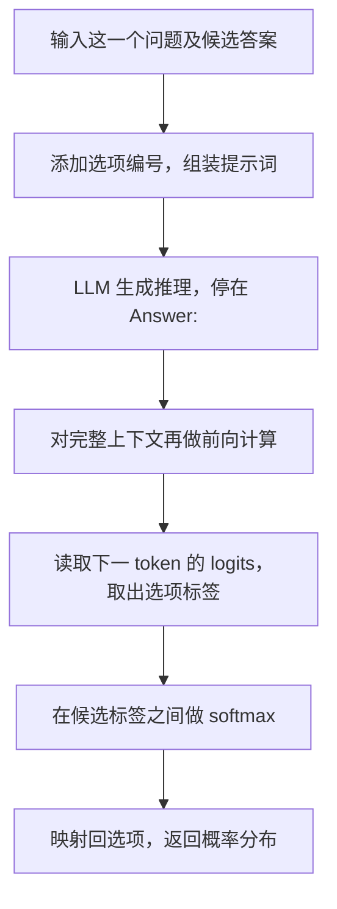

最近在读 *OpenJev-RLCD: A Working RLCD Implementation*。这篇先整理我对三个问题的理解：一个事件的真实概率是什么，怎样评价模型对它的概率预测，以及 LLM 如何输出候选答案的概率。具体的 RLCD 训练方法留到后面继续讨论。

> 本文对应[论文 arXiv v1](https://arxiv.org/abs/2609.38850v1)，代码示例基于提交 [`0de429f`](https://github.com/ZimmyGao/openjev-rlcd/tree/0de429fd49627e98e9ad9aeb83ff4f43dc66c963)。图表和示例输出中的数值均用于解释概念，不是模型实测结果。

## 1. 校准概率任务的定义

生活中的很多预测都带有不确定性。比如，两个电竞战队即将进行比赛，我们通常不只会预测谁获胜，还会说双方“四六开”或者“二八开”。这些概率描述了我们对这场比赛结果的判断，也比单独给出一个获胜队伍提供了更多信息。

**下面始终讨论条件固定的同一场比赛。** 假想双方的选手状态、比赛版本等条件完全保持不变，我们独立地重复这场比赛。如果重复 100 次，A 队赢了 40 次，得到的获胜频率就是 0.4；当重复次数足够多时，这个频率会趋近 A 队在这些条件下的真实胜率。

用 $$N_A(n)$$ 表示前 $$n$$ 次假想重复中 A 队获胜的次数，那么：

$$
\frac{N_A(n)}{n}\xrightarrow[n\to\infty]{}q_A.
$$

假设这场比赛的真实胜率是 A 队 40%、B 队 60%，它的真实结果分布就记为：

$$
q=(0.4,\;0.6).
$$


_图 1：设定 A 队真实胜率为 0.4，模拟同一场比赛的独立重复，用频率变化说明真实概率的含义。_

现实中无法让同一场比赛在完全相同的条件下反复发生。因此，我们只能根据两队过往的战绩、选手状态和近期表现等信息，给出一个预测分布，记为 $$p$$。

这也是我理解校准决策任务的出发点：**希望模型对这个事件报告的概率 $$p$$，能够尽可能接近它的真实分布 $$q$$。** 要评价这个估计好不好，就需要一个衡量概率预测偏差的目标。

## 2. 用交叉熵评价模型的概率预测

在学习这部分时，我也顺带接触了一些信息论知识。交叉熵可以用来理解上面这个目标。

对于一个有 $$K$$ 种可能结果的事件，设真实分布为 $$q$$、模型预测分布为 $$p$$，交叉熵为：

$$
H(q,p)=-\sum_{k=1}^{K}q_k\log_2 p_k.
$$

这里的求和遍历的是**同一事件的不同可能结果**。以比赛为例，就是分别考虑 A 队获胜和 B 队获胜。使用以 2 为底的对数时，交叉熵的单位是 bit。

仍然固定这场比赛的真实分布 $$q=(0.4,0.6)$$，比较两个预测：

| 预测分布 | A 队获胜概率 | B 队获胜概率 | 交叉熵 $$H(q,p)$$ |
|---|---:|---:|---:|
| $$p_1$$ | 0.4 | 0.6 | 约 0.971 bit |
| $$p_2$$ | 0.1 | 0.9 | 约 1.420 bit |

两个模型都会预测 B 队获胜，但 $$p_2$$ 把 B 队的获胜概率估得过高。当结果按真实分布发生时，$$p_2$$ 的平均对数损失更大，因此它的交叉熵更高。

对于固定的真实分布 $$q$$，交叉熵关于预测分布 $$p$$ 是凸函数，并且在 $$p=q$$ 时取得最小值。这个性质也可以通过下面的关系理解：

$$
H(q,p)=H(q)+D_{\mathrm{KL}}(q\|p).
$$

其中，$$H(q)$$ 是真实分布的熵，在这里保持不变；KL 散度 $$D_{\mathrm{KL}}(q\|p)$$ 非负，在 $$p=q$$ 时为零。因此，降低交叉熵损失，就是减小预测分布与真实分布之间的这项偏差。


_图 2：固定 $$q=(0.4,0.6)$$，改变模型对 A 队获胜的预测概率 $$p_A$$；最低点对应 $$p=q$$。_

所以，我这里想表达的优化过程就是：**通过降低交叉熵损失，让模型报告的概率逼近这个事件的真实概率。**

实际应用中，真实分布通常未知。怎样利用可观察的结果和采样设计训练方法，后面再继续讨论。这里先明确概率预测希望优化的方向。

## 3. 基于 LLM 的校准概率模型

### 3.1 从 Jev 的接口看输出形式

[TypeSafe AI](https://typesafe.ai/) 推出的 Jev 可以根据输入的问题返回候选选项的概率。厂商将其训练方法称为 **Reinforcement Learning for Calibrated Decisions（RLCD）**。

沿用前面这场比赛的例子，按照[官方 Choice 接口](https://docs.typesafe.ai/primitives/choice)，请求体可以写成：

```json
{
  "model": "jev-latest",
  "state": "一场虚构的 A 队对 B 队比赛。A 队近 10 场 6 胜，B 队近 10 场 7 胜；双方均以常规阵容参赛。",
  "questions": {
    "winner": {
      "type": "choice",
      "instructions": "根据已知信息，判断哪支队伍更可能获胜。",
      "criteria": {
        "team_a": "A 队获胜",
        "team_b": "B 队获胜"
      }
    }
  }
}
```

我们关心的返回字段类似下面这样，数值仅为示意：

```json
{
  "choice": "team_b",
  "probabilities": {
    "team_a": 0.4,
    "team_b": 0.6
  }
}
```

本文参考的 [OpenJev-RLCD](https://github.com/ZimmyGao/openjev-rlcd) 是一个独立的社区实现。接下来先看它怎样利用 LLM 构造这种概率输出，具体的训练算法留到下一篇讨论。

### 3.2 从下一 token 的概率到选项概率

自回归 LLM 每生成一个 token，都会根据已有上下文，计算词表中各个 token 作为下一项的分数。语言模型输出头 `lm_head` 给出的这些分数叫作 **logits**，经过 softmax 后，得到词表上的概率分布：

$$
P(t=v\mid\text{context})
=\frac{\exp(z_v)}{\sum_{w\in V}\exp(z_w)}.
$$

其中，$$V$$ 是词表，$$z_v$$ 是 token $$v$$ 对应的 logit。

如果约定 `A` 表示“A 队获胜”、`B` 表示“B 队获胜”，那么到达答案位置时，就可以取出这两个标签 token 的 logits，只在它们之间做 softmax。这样，词表上的下一 token 预测就转成了这道问题的选项分布。


_图 3：示意中，标签 A、B 的原始 token 概率分别是 8% 和 12%；在两个选项内部归一化后，得到 40% 和 60%。_

从全词表概率中取出候选标签再归一化，与直接对候选 logits 做 softmax 等价，因为全词表 softmax 的公共分母会约掉。

### 3.3 结合代码看完整的读取过程

项目的 MMLU-Pro 任务先给候选答案添加字母编号，再要求模型简短推理，并以 `Answer: X` 的形式结束。沿用这个消息格式，把前面的比赛问题代入：

```python
item = {
    "question": (
        "A 队近 10 场 6 胜，B 队近 10 场 7 胜，双方均以常规阵容参赛。"
        "这场比赛谁会获胜？"
    ),
    "options": ["A 队获胜", "B 队获胜"],
}
LETTERS = "ABCDEFGHIJ"

opts = "\n".join(
    f"{LETTERS[i]}. {option}"
    for i, option in enumerate(item["options"])
)
tail = "简短地逐步推理，然后严格以一行 'Answer: X' 结束，其中 X 是选项字母。"
user_text = f"Question: {item['question']}\n\nOptions:\n{opts}\n\n{tail}"

prompt = tok.apply_chat_template(
    [{"role": "user", "content": user_text}],
    tokenize=False,
    add_generation_prompt=True,
    enable_thinking=False,
)
```

上面的代码保留了源码的组装方式，将提示词译为中文并省略外围逻辑。对应的用户消息正文为：

```text
Question: A 队近 10 场 6 胜，B 队近 10 场 7 胜，双方均以常规阵容参赛。这场比赛谁会获胜？

Options:
A. A 队获胜
B. B 队获胜

简短地逐步推理，然后严格以一行 'Answer: X' 结束，其中 X 是选项字母。
```

> 源码：[mmlu_pro.py 的 `user_message()`](https://github.com/ZimmyGao/openjev-rlcd/blob/0de429fd49627e98e9ad9aeb83ff4f43dc66c963/openjev_rlcd/tasks/mmlu_pro.py) 组装问题和选项；[tasks/__init__.py 的 `prompt()`](https://github.com/ZimmyGao/openjev-rlcd/blob/0de429fd49627e98e9ad9aeb83ff4f43dc66c963/openjev_rlcd/tasks/__init__.py) 应用聊天模板。

把提示词交给模型后，它开始逐个 token 生成推理。代码用 `stop_strings=["Answer:"]` 设置停止标记，在模型写出 `Answer:` 后停下，此时尚未生成最终选项标签。

接着，项目把“提示词 + 已生成的推理”作为完整上下文，再做一次前向计算，从最后一个有效位置读取下一 token 的 logits。取出候选标签对应的分数并归一化，核心源码如下：

```python
h = model.model(
    input_ids=ids, attention_mask=mask, use_cache=False
).last_hidden_state

z = model.lm_head(h[rows, last])[:, self.label_ids].float()
u = z.softmax(-1)
```

其中，`last` 是各条上下文最后一个有效 token 的位置，`self.label_ids` 是候选标签对应的 token id。项目使用带前导空格的标签，例如 `" A"`、`" B"`；读取时需要确认标签在当前 tokenizer 中是单个 token。

> 源码：[train.py 的 `Rationales.sample()` 和 `Rationales.forward()`](https://github.com/ZimmyGao/openjev-rlcd/blob/0de429fd49627e98e9ad9aeb83ff4f43dc66c963/openjev_rlcd/train.py)。如果生成结束时缺少 `Answer:`，实现会补上这个标记再读取分布；当前题目不存在的选项也会被屏蔽。

用 $$a_k$$ 表示第 $$k$$ 个选项的标签 token id，$$x$$ 表示问题，$$r$$ 表示本次生成的推理，读出的分布就是：

$$
u_\theta(x,r)_k
=\frac{\exp(z_{a_k})}{\sum_{j=1}^{K}\exp(z_{a_j})}.
$$

这个 $$u_\theta(x,r)$$ 就是前面讨论的预测分布 $$p$$ 在 LLM 中的一种实现。完整流程可以概括为：



_图 4：从一个问题到它的选项概率分布。_

到这里，我们就得到了一组可读取的选项概率。接下来要做的，是利用实际结果和合适的训练目标，让这组概率更接近所预测事件的真实分布。OpenJev-RLCD 的具体评分与训练方法，留到下一篇继续理解。
